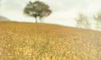
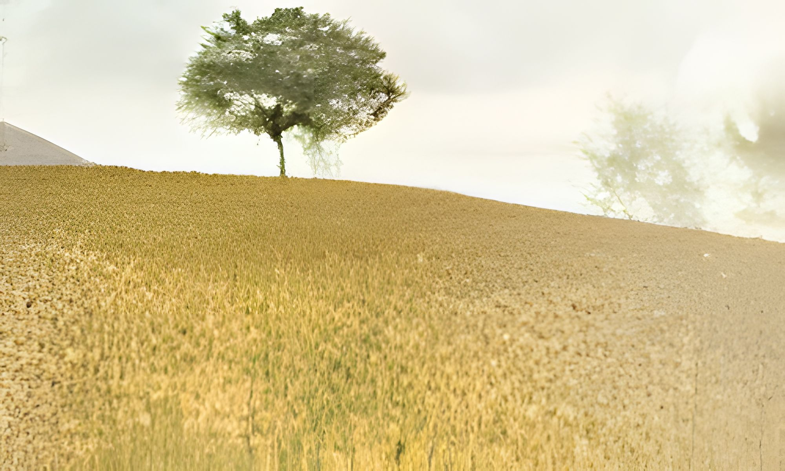

<div align="center">

# Image Compare

### See the difference. Keep the detail.

A browser-based image comparison workspace for before-and-after edits, visual checks, and AI upscale inspection. Six comparison modes. Synchronized navigation. No image uploads.


[Quick start](#quick-start) · [Features](#features) · [How it works](#resolution-independent-comparison) · [Shortcuts](#keyboard--pointer-controls) · [Report an issue](https://github.com/Zappu1204/compare-img/issues)

</div>

---

## Why Image Compare?

A low-resolution original and a high-resolution upscale should not have to share a pixel buffer to share a viewport. Image Compare keeps both decoded raster images at their native dimensions and maps them into the same display area, so you can inspect the detail an upscale actually contains.

Use it to review retouching, compare compression settings, inspect AI-enhanced images, or find small visual changes without sending your files to a server.

<table>
  <tr>
    <th>Original sample</th>
    <th>Upscaled sample</th>
  </tr>
  <tr>
    <td align="center"></td>
    <td align="center"></td>
  </tr>
</table>

*Bundled input images, not a screenshot of the application. Load them from [`public/samples/`](public/samples/) to inspect the pair yourself, or use **Try a sample pair** for the built-in SVG demo.*

## Features

### One workspace, six ways to compare

| Mode | Key | Best for |
| --- | --- | --- |
| **Split** | `1` | Wipe between images with a draggable vertical or horizontal divider. |
| **Side by side** | `2` | Compare columns or stacked rows with synchronized pan and zoom. |
| **Fade** | `3` | Blend image B over A with a 0–100% opacity control. |
| **Difference** | `4` | Highlight pixel changes with threshold, amplification, heatmap, grayscale, or red-mask controls. |
| **Flicker** | `5` | Alternate between images at an adjustable interval to reveal small shifts. |
| **Spyglass** | `6` | Reveal B through a movable circular lens with adjustable size and magnification. |

### Built for close inspection

- **Flexible input:** drag and drop, choose files, or paste an image with `Ctrl+V` / `Cmd+V`.
- **Shared navigation:** cursor-anchored wheel zoom, drag to pan, touch pinch, and Fit / 100% / 200% / 400% presets.
- **Native-resolution inspection:** keep the original raster buffers; use smooth or nearest-neighbor rendering for magnified image A.
- **Alignment tools:** shift image B on the X/Y axes, nudge with the keyboard, and swap A/B instantly.
- **Channel views:** inspect RGB, individual red/green/blue channels, or grayscale.
- **Useful image facts:** dimensions, aspect ratio, file size, and per-image render-scale readouts for different resolutions.
- **Focused workspace:** neutral `#121212` canvas, collapsible panels, fullscreen, labels, and a transparency grid.
- **PNG exports:** save the rendered comparison view or the calculated difference map.

## Quick start

### Requirements

- **Node.js 20.19+ on the 20.x line, or Node.js 22.12+**; a current supported LTS release is recommended.
- **npm** and **Git**.
- A modern browser with Canvas 2D, `ImageBitmap`, `OffscreenCanvas`, and Web Worker support.

```sh
git clone https://github.com/Zappu1204/compare-img.git
cd compare-img
npm ci
npm run dev
```

Open the local URL printed by Vite, usually **http://localhost:5173**.

No API keys, environment variables, database, or application backend are required.

### Your first comparison

1. Drop two images into the workspace, choose files, or select **Try a sample pair**.
2. Treat **A** as the original / before image and **B** as the edited / after image.
3. Choose a mode from the toolbar or press `1`–`6`.
4. Zoom into a detail, pan around, and adjust the mode controls in the right panel.
5. Select **Export view**, or switch to **Difference** and select **Diff** once its map is ready.

With both slots filled, dropping a single image on the left half replaces A; dropping it on the right half replaces B. Use each image card's **Replace** button when you want an explicit target.

### Production build

```sh
npm run typecheck
npm run build
npm run preview
```

The production bundle is written to `dist/`. Deploy that directory to a static host. The Vite configuration uses relative asset paths (`base: './'`) so the build can be hosted under a subdirectory.

Use an HTTP(S) server to serve the build rather than opening `dist/index.html` through `file://`; the application uses JavaScript modules and a worker.

## Resolution-independent comparison

### Same content, different pixel grids

For display, both images occupy a shared reference box based on A's dimensions. A single viewport transform keeps the same relative location aligned across modes, even when B has a different native resolution.

For example, compare a **500 × 500** original with a **2000 × 2000** upscale:

| Viewport zoom | A render scale | B render scale |
| --- | --- | --- |
| 100% | 100% | 25% |
| 400% | 400% | 100% |

At 400%, the baseline is magnified while the upscale has enough native pixels to fill the same area without enlargement. The toolbar's zoom is relative to **A**, not a promise that both images are simultaneously at 1:1. Display density also depends on the device pixel ratio.

**The original decoded raster buffers are not resized to match each other.** The renderer may use cached, downscaled display copies while zoomed out; these do not replace the native buffers. Native sources are used at or above their native render scale.

> **Aspect ratios matter.** Both images are mapped into the same display box. Different aspect ratios are stretched to match rather than automatically cropped, registered, or aligned by content. For faithful upscale inspection, use matching framing and aspect ratios.

### Difference mode is a separate calculation

Pixel differencing requires a shared pixel grid. The diff engine selects the image dimensions with the **larger total pixel count** and projects the other image onto that grid, leaving both source buffers intact.

- A pixel is counted as changed when its maximum absolute **RGBA channel difference** exceeds the threshold.
- Amplification makes faint differences more visible; it does not change the threshold's changed-pixel classification.
- Heatmap, grayscale, and red-mask styles offer different ways to read the result.
- The exported diff uses the calculated map's dimensions, independent of viewport zoom.

This is a pixel comparison, **not** a perceptual similarity score, SSIM metric, or automated assessment of upscale quality. Resampling between different source grids can itself produce visible differences.

## Keyboard & pointer controls

| Control | Action |
| --- | --- |
| `1`–`6` | Switch comparison mode, in toolbar order. |
| Hold `Space` | Temporarily reveal the alternate image outside Flicker mode. |
| `Space` in Flicker | Play or pause automatic alternation. |
| Mouse wheel | Zoom around the cursor. |
| Drag / two-finger pinch | Pan / zoom. |
| Double-click | Toggle between Fit and 100%. |
| `0` | Reset pan and zoom to Fit. |
| `S` | Swap A and B. |
| `X` | Flip the split direction or side-by-side layout. |
| Arrow keys | Move the divider in Split; otherwise nudge B's alignment. |
| `Shift` + arrow keys | Use a larger, 10-step nudge. |
| `L` | Toggle image labels. |
| `H` | Hide or show the side panels. |
| `F` | Toggle fullscreen. |
| `E` | Export the current comparison view as PNG. |
| `?` | Open the shortcuts reference. |
| `Esc` | Close the shortcuts reference. |
| `Ctrl+V` / `Cmd+V` | Paste an image from the clipboard. |

Application shortcuts are suppressed while an input, slider, select, or editable field has focus.

## Privacy & supported files

**Your selected images are decoded, rendered, and compared inside the browser tab.** The application has no image-upload endpoint, account system, or image-processing backend. It does not persist image files or workspace state to browser storage; refreshing the page starts a new session.

The page and JavaScript assets still need to be loaded from wherever you host the app. Selecting the built-in demo fetches the bundled sample files from that same host. These requests do not upload your selected images.

| Input | Notes |
| --- | --- |
| PNG, JPEG, WebP, AVIF | Decoded through the browser's image support. |
| GIF, BMP | Accepted when supported by the browser; there is no animation playback or frame-selection UI. |
| SVG | Rasterized on import to a width of **1600 px**; its aspect ratio is derived from decoded dimensions or the `viewBox`. It is not retained as a scalable vector for inspection. |

### Practical limits

- **Memory:** high-resolution comparisons can use substantial RAM. One 7680 × 4320 RGBA buffer is about 127 MiB, and a diff needs multiple buffers in addition to source images and display caches.
- **Browser limits:** maximum image and canvas sizes vary by browser and device. Very large inputs or exports can fail when memory or canvas limits are exceeded.
- **Export scope:** **Export view** renders the canvas comparison at twice the viewport's CSS dimensions, including comparison overlays but not the HTML toolbar or side panels. It is not an export of both native source files.
- **Color:** decoding, interpolation, and color handling depend on the browser. This is not a color-managed proofing tool.
- **Compatibility:** AVIF decoding, fullscreen, touch behavior, and clipboard image availability depend on the browser and operating system.

## Development

Built with **React 19**, **TypeScript**, **Vite 8**, and **Tailwind CSS 4**. Rendering uses the **Canvas 2D API**; pixel differences run in a **Web Worker**.

| Command | Purpose |
| --- | --- |
| `npm ci` | Install the dependency versions from `package-lock.json`. |
| `npm run dev` | Start the Vite development server. |
| `npm run typecheck` | Run the TypeScript project checks without emitting output. |
| `npm run build` | Check TypeScript and create the production bundle. |
| `npm run preview` | Serve the production bundle locally for review. |

### Project layout

```text
src/
├── core/              # Image loading, preparation, rendering, transforms, exports
│   ├── diff/          # Diff worker and request coordination
│   └── mip.ts         # Zoomed-out display caches
├── hooks/             # Input, clipboard, keyboard, pointer, and canvas sizing
├── state/             # React state and mutable render-scene coordination
├── ui/                # Workspace, toolbars, panels, and comparison controls
├── App.tsx            # Application shell
└── types.ts           # Shared types and settings
public/samples/        # Bundled demo and inspection images
verify/                # Browser verification scripts and probes
```

The render scene is kept outside React's render cycle so pointer interactions can request canvas frames without rebuilding the component tree. The diff worker reuses uploaded pixel data and coalesces subsequent settings changes.

Browser verification scripts live in [`verify/`](verify/). They are development utilities, not a configured `npm test` suite; check each script's server, browser, and output-path assumptions before running it.

## Contributing

Bug reports and focused improvements are welcome via [issues](https://github.com/Zappu1204/compare-img/issues) and pull requests.

1. Describe the problem or proposed change, including browser and OS details for rendering issues.
2. Keep changes focused and avoid resizing source buffers just to align display layers.
3. Run `npm run typecheck` and `npm run build`.
4. For rendering changes, check equal-size and mixed-resolution pairs, swap A/B, inspect more than one mode, and verify PNG exports.
5. Attach a small reproducible example or screenshots when helpful. Do not include private images or local conversation logs.

## License

This repository does not currently include a `LICENSE` file. No open-source license is declared; do not assume permission to redistribute or reuse the code or bundled images beyond applicable law. Licensing should be clarified with the repository owner before reuse.

---

<div align="center">

**Compare the images, not the viewer's shortcuts.**

[Back to top](#image-compare)

</div>